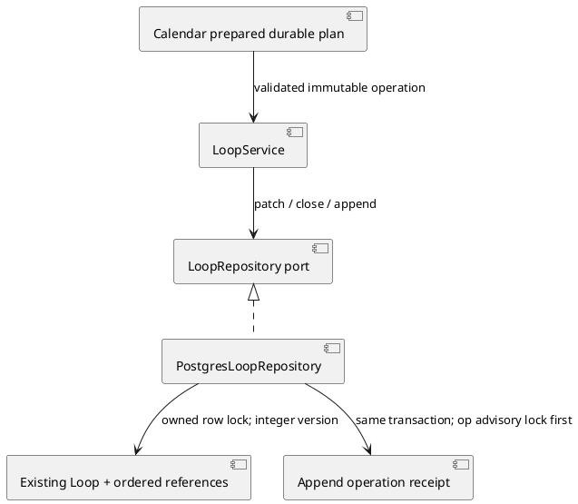
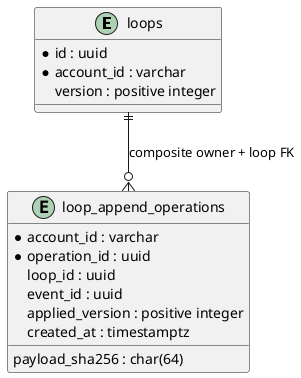

# Calendar association and concurrent Loop mutations

This source component is implemented locally. It does not activate a Calendar
credential, migrate a canonical database, release a service, or prove model
selection quality. REST/JWT/MCP/UI integration and runtime verification remain
with the Calendar implementation owner.

## Existing records and freshness

Migration `007_loop_mutation_versions.sql` is additive. Existing Loops receive
integer version 1; prior migration files and rows/references are preserved.
The maintained `src/entrypoints/migrate.ts` CLI explicitly registers007 after006;
the runtime image includes that bundled CLI and its migration directory. The
real `LoopMigrationRunner.integration.test.ts` regression starts with001–006
and an existing Loop/reference, executes the bundled CLI, checks preserved
rows and historical checksums, and repeats it to verify migration idempotence.
This isolated-schema evidence does not imply a canonical database migration.
`Loop.version` is returned with a coherent single-statement row/reference
snapshot. It is the freshness fence; JavaScript timestamp precision is not CAS.

`LoopService.update` validates only supplied fields and calls a row-locked
repository patch. Omitted scalar fields and references remain untouched.
Description/due-date null explicitly clears the field. Replacing
`relatedRecords`, including an empty array for unlink, requires the current
positive integer `expectedVersion`; a stale replacement returns a typed409
conflict. Scalar patches may optionally carry the same CAS fence. Legacy
repository full-snapshot `save` also checks its version under the row lock, so
it cannot silently overwrite an append with an earlier snapshot.

Closing requires literal `confirmed: true`, takes the same owned row lock, and
changes only the fresh current row's closure metadata. It does not rewrite
references from a stale pre-lock snapshot. Already-closed replay is unchanged;
new edits/associations/comments on a closed Loop are rejected.

Every actual Loop scalar/reference mutation, seeded-reference addition and
profile comment increments the version once. An identical patch, repeated
close, or duplicate existing reference changes neither version nor timestamps.
Initial creation starts at1. Seed reconciliation preserves existing scalars and
labels, appends only absent identities under the lock, and rejects additions to
a closed Loop. This version does not claim to version independently owned source
records or external tag-catalogue records.

## Restricted Calendar append and durable intent

`appendReference(accountId,id,sub,{operationId,eventId,record},now)` appends only
an existing Calendar event pointer: kind `appointment`, recordId
`calendar:<canonical-event-UUID>`, fixed nonprivate label `Calendar event`.
The application validates UUIDs and the fixed payload. The transport owner must
derive these values from the actual signed event/job binding, not trust model-
chosen owner, event, Loop or reference data. This helper adds no new Loop or
business-content cache and has no provider dependency.

The append operation first takes a transaction advisory lock on the
account/operation identity, then the owned Loop row lock. Its receipt and any
new reference are committed together. The durable receipt's key is
`(account_id, operation_id)` and binds Loop ID, event ID and the SHA256 of the
canonical exact payload. Reusing an operation for different bound values is a
409 conflict. No receipt is created for a failed foreign-owner, closed, invalid
or capacity-rejected append. At most100 references are allowed.

The return contract is `{loop, appended, replayed, referencePresent,
appliedVersion}`. `loop` is the current coherent snapshot. `appliedVersion` is
the receipt's immutable first-application version, including when a reference
was already present and the receipt was created without a Loop change.
`referencePresent` describes the current snapshot, not a historical assertion.
An identical operation retry never appends or increments version again—even
if a later human explicitly unlinked the event or closed the Loop. It returns
`replayed: true`, `appended: false`, current presence and the original applied
version. Receipt rows must not be routinely pruned: they preserve that intent.

Calendar must persist its exact plan/operation identity before dispatch. An
ambiguous reply retries that same operation/payload rather than asking the model
for a replacement. A committed Lists receipt and a Calendar result are not a
cross-service atomic transaction; the caller reconciles the returned current
presence and must not claim a link solely from a historical receipt.

## Architecture and ERD additions (source component)





The Calendar owner integrates the shared package diagram/ERD, requirements,
controller conflict mapping, transport contract and screen matrix. No UI or
new delegated-authority claim follows from this isolated helper.

## Rerunnable verification

Use pinned Node24.18.0. From this repository:

```
CALENDAR_LOOP_TEST_PG=local-disposable-schema node node_modules/vitest/vitest.mjs run tests/application/LoopMutation.test.ts tests/adapters/LoopConcurrency.integration.test.ts
CALENDAR_LOOP_TEST_PG=local-disposable-schema node node_modules/vitest/vitest.mjs run
node node_modules/typescript/bin/tsc --noEmit
```

The integration suite connects to native local `/tmp` PostgreSQL database
`postgres` as the OS user. It creates a unique UUID-named schema, applies real
migration files there, and drops only the schema it actually created, verifying
absence. It never migrates canonical tables. Actual separate PostgreSQL writers
queue behind explicit row-lock barriers; `pg_stat_activity` confirms lock waits
before release. Both close/append orders, disjoint scalar updates, two distinct
appends, stale full save, explicit reference CAS, duplicate/replayed append,
post-unlink replay, foreign ownership, seed/comment versions and migration replay
are exercised. No external providers, canonical runtime or business records are
used. Test-only InMemory repository support is not real concurrency evidence.

## REST integration under qualification

Loop responses now expose the integer `version`. An explicit `relatedRecords` replacement must include the observed positive `expectedVersion`; stale replacement is a 409 and omitted references remain untouched in metadata-only PATCH. Closed mutations conflict rather than reopening the Loop.

A named `life2-calendar-triage` job delegation may read Loops and POST `{expectedVersion}` to `/v1/loops/{id}/calendar-reference`. The controller derives the immutable operation ID and event ID from verified named JWT claims, and derives the sole reference `{kind: appointment, recordId: calendar:<event UUID>, label: Calendar event}`. Caller-selected records or operation IDs are rejected. First application checks the observed Loop version under lock; exact receipt replay respects later human changes instead of reapplying. The response distinguishes appended/replayed/current reference presence; a historical receipt does not override a later human unlink. This route does not allow creating, closing, commenting or editing Loops, or accessing Todoist-backed Task Lists. Ordinary user routes and existing email-agent task-dispatch boundaries remain separate.

These source tests are not evidence of canonical migration, local activation, production release or a genuine model decision.

## First-application semantic freshness fence (incremental correction)

`CalendarReferenceAppend.expectedVersion` is optional for existing core callers
and must be a positive integer when provided. The Calendar REST boundary requires
it from the actual Loop snapshot observed during the saved association plan.
For an operation without an existing receipt, the repository checks that exact
version only after acquiring the owned Loop row lock and reading its current
snapshot. A mismatch returns409 before any reference mutation or receipt insert,
including when a metadata edit completed while the append waited for the lock.
This prevents linking against an obsolete Loop meaning/outcome.

An existing identical operation receipt is reconciled before the new-current-
version check. Its replay returns the current Loop/presence and original
`appliedVersion`, never a second effect. The expectedVersion admission fence is
intentionally excluded from immutable payload identity (account/event/Loop/fixed
record remain bound): changing a positive fence on replay cannot change or
reapply the saved intent. An old attempt remains replayable after human unlink
or closure; it cannot restore the removed reference. The caller should retain
its original exact plan and must not substitute a new model proposal on retry.

The incremental real-PG regression queues a human metadata patch before the
stale first append behind an explicit row lock, verifies409/zero receipts/zero
new refs, applies a fresh intent, unlinks/closes as a human, and verifies old
receipt reconciliation still reports absent/currentversion without reappend.
UNIT negatives reject nonpositive, fractional, string and null supplied versions.

## Calendar context search bound

Calendar job delegations must GET `/v1/loops` with `status=open`, a2–120-character literal `query`, and an integer `limit`1–5. The owning PostgreSQL query applies tenant, open-state, literal `strpos` matching and `LIMIT` before transport; unbounded Calendar list requests fail400. Ordinary interactive list reads retain their existing contract. Exact Loop detail and the derived idempotent append remain separate. This changes no database shape.

Reserved Calendar scopes (`life2:calendar-context` and `life2:calendar-triage`) identify the Calendar delegation family even when application/event/job markers are absent. Such incomplete signed grants fail closed; they cannot fall through to ordinary interactive authority. Normal interactive scopes and complete named Calendar grants retain their existing contracts. This is a validation correction, with no schema change.
